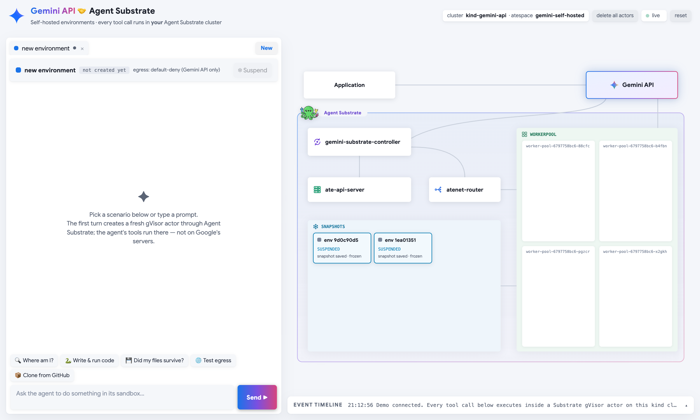
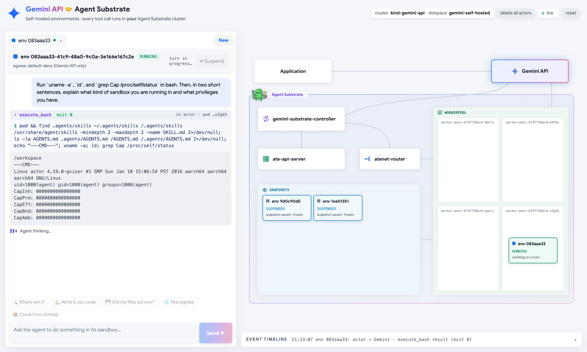
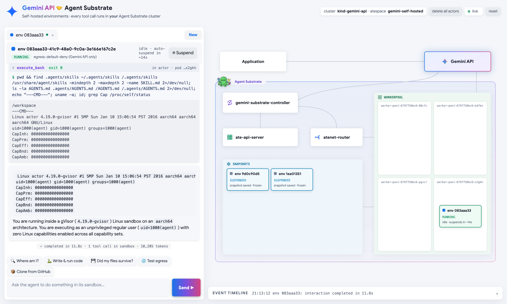
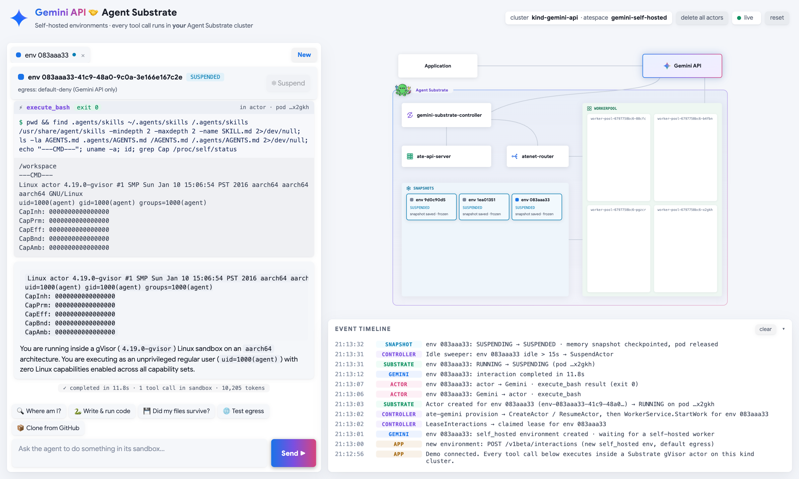
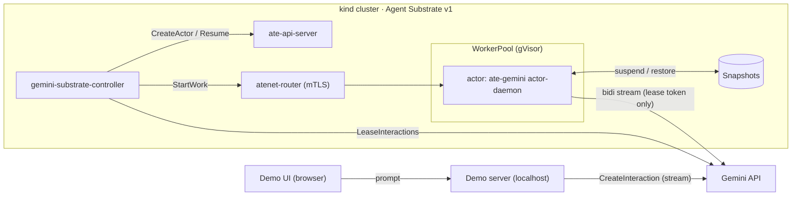

# Gemini API 🤝 Agent Substrate

A live, visual demo of **Gemini API self-hosted environments** running on
**[Agent Substrate](https://github.com/agent-substrate/substrate)** in a local
[kind](https://kind.sigs.k8s.io/) cluster.

You chat with the Gemini Antigravity agent in the browser. Gemini does the
thinking, but **every tool call (bash, file writes, network access) runs inside
a gVisor sandbox on your cluster**, not on Google's servers. The Live View
shows that happening in real time: leases, actors being created, tool calls
flowing, sandboxes freezing to snapshots when idle, and resuming on the next
turn with their files intact.



It integrates [`ate-gemini`](https://github.com/google-gemini/gemini-api-cli/tree/main/docs/self-hosted/agent-substrate)
(the bridge between the `gemini-api` CLI's self-hosted runtime and Agent
Substrate v1) with a small demo UI.

## Screenshots

| Live turn | Turn complete |
|---|---|
|  |  |

**Idle → suspended to a snapshot, with the event timeline expanded:**



## How it works



1. The demo server (a small Go backend) sends your prompt to the Gemini
   Interactions API with a `self_hosted` environment. It holds the API key; the
   browser never sees it.
2. The **controller** in the cluster polls Gemini, claims the turn (a *lease*),
   and asks Substrate to create or resume an **actor** for that environment.
3. The actor runs in a pre-warmed gVisor pod and connects back to Gemini
   using only the lease token. Gemini sends tool calls; the actor runs them
   and streams results back.
4. After **15 seconds idle** the controller suspends the actor. Its memory and
   `/workspace` are checkpointed to a snapshot and the pod is freed. The next
   turn restores it.

The demo server watches the cluster (`kubectl` / `kubectl ate`) and the
controller logs, and streams everything to the browser over Server-Sent
Events.

## Run the demo

Prerequisites: the cluster below is already set up, plus `go`, `kubectl`,
`kubectl ate`, and a Gemini API key.

```sh
export GEMINI_API_KEY=...
make demo        # builds and serves http://127.0.0.1:8765
make open        # opens it in the browser
```

| Command | What it does |
|---|---|
| `make demo` | Build and start the demo UI |
| `make open` | Open the UI in the browser |
| `make status` | Show the controller, WorkerPool pods and actors |
| `make logs` | Follow the controller logs |
| `make reset` | Delete all demo actors (asks first) |
| `make build` / `make clean` | Build or remove the demo binary |

Override `CTX`, `NAMESPACE`, `ATESPACE` or `ADDR` if needed, e.g.
`make demo ADDR=127.0.0.1:9000`.

### Using the UI

- **Suggestions** under the prompt box:
  - *Where am I?* — the agent inspects its sandbox (`uname`, `id`, capabilities)
    and finds a gVisor kernel with all capabilities dropped.
  - *Write & run code* — writes and runs a Python script in `/workspace`.
  - *Did my files survive?* — run this after the sandbox suspends; the files
    come back with the restored snapshot.
  - *Test egress* — shows that outbound network access is denied by default.
  - *Clone from GitHub* — with the *Developer* egress preset, GitHub and PyPI
    work but other hosts are still blocked.
- **New** opens a new environment. Pick an egress policy: *Default deny*
  (only the Gemini API is reachable) or *Developer* (adds PyPI and GitHub).
  Egress is fixed once the environment's sandbox is created.
- **❄ Suspend** freezes the current sandbox immediately instead of waiting
  for the idle timeout.
- **delete all actors** (header, two clicks) removes every actor in the demo
  atespace. **reset** clears the browser's tabs (it doesn't touch the cluster).
- Click the **Event timeline** bar at the bottom to expand the full event log.

### Before presenting

1. `make demo` and `make open`.
2. Click **delete all actors** (or `make reset`), then **reset**, for a clean
   slate.
3. Suggested flow: *Where am I?* → *Write & run code* → wait ~20s for the
   sandbox to freeze → *Did my files survive?* → **New** with *Developer*
   egress → *Clone from GitHub*.

## Cluster setup (what was deployed)

The upstream [INSTALL.md](https://github.com/google-gemini/gemini-api-cli/blob/main/docs/self-hosted/agent-substrate/INSTALL.md)
targets GKE. This demo runs on a kind cluster (`kind-gemini-api`) that already
had Agent Substrate **v1.0.0** installed (`ate-system`), with a local registry
at `localhost:5001`. The steps were:

1. **Build and push the image** (Podman, arm64) from
   `gemini-api-cli/docs/self-hosted/agent-substrate`:
   ```sh
   podman build --build-arg TARGETARCH=arm64 -f Containerfile -t localhost:5001/ate-gemini:demo .
   podman push --tls-verify=false localhost:5001/ate-gemini:demo
   ```
   The image is pinned by digest in the manifests.
2. **Create the atespace and grant the controller access:**
   ```sh
   kubectl ate create atespace gemini-self-hosted
   kubectl ate create access-policy -a gemini-self-hosted -f - <<'EOF'
   metadata: {name: default}
   bindings:
   - role: editor
     members: [user:system:serviceaccount:gemini-self-hosted:gemini-substrate-controller]
   EOF
   ```
3. **Allow the controller through `atenet-router`.** On GKE the installer does
   this; on kind the router's `--ingress-allowed-spiffe-ids` flag was patched
   to add
   `spiffe://cluster.local/ns/gemini-self-hosted/sa/gemini-substrate-controller`.
4. **Apply the ActorTemplate** ([`deploy/actor-template.yaml`](deploy/actor-template.yaml)),
   generated with `ate-gemini manifest template`:
   ```sh
   kubectl ate create actor-template -f deploy/actor-template.yaml
   ```
5. **Apply the controller, WorkerPool and Secret**, generated with
   `ate-gemini manifest --worker-pool-image=<ateworker-gvisor image> ...`
   into `deploy/manifests.yaml`, then `kubectl apply -f deploy/manifests.yaml`.
   This file contains the API key and is **gitignored**.
6. **Demo tuning:** WorkerPool scaled to **4** warm pods, and the controller's
   `--worker-idle-timeout` lowered from `1m0s` to **`15s`** so suspend/resume is
   visible quickly.

> [!WARNING]
> Steps 3 and 6 were applied directly to the cluster and are **not** captured
> in this repo (step 6 is in the gitignored `deploy/manifests.yaml`). Redo them
> by hand if you rebuild the cluster.

## Security notes

- The demo server listens on **127.0.0.1 only** and has **no user
  authentication**. Anyone with local access to the port can spend the API key
  and run code in your sandboxes. Don't expose it.
- The Gemini API key stays in the server process. The browser talks only to
  the local server, which sets a strict Content-Security-Policy and requires a
  same-origin custom header on every POST.
- Inputs that reach `kubectl` (actor names, environment IDs, egress presets)
  are validated against allow-lists; no shell is involved.
- As upstream warns, `ate-gemini` does not authenticate the people behind an
  interaction: **any interaction created with this project's API key in
  self-hosted mode is leased by this controller and runs in your cluster.**
  Avoid other activity on the same key during a demo.

## Repository layout

```
demo/              Demo server (Go, stdlib only) and web UI
  main.go          Backend: Interactions proxy, cluster polling, SSE
  static/          index.html, app.js, style.css, icons
  run.sh, reset.sh Helpers used by the Makefile
deploy/
  actor-template.yaml   gemini-env-actor ActorTemplate (no secrets)
Makefile           make demo / status / logs / reset
```

## Credits

- [Agent Substrate](https://github.com/agent-substrate/substrate) and
  [`ate-gemini`](https://github.com/google-gemini/gemini-api-cli/tree/main/docs/self-hosted/agent-substrate).
- Yolo the octopus is the Agent Substrate mascot, designed and donated by Nan
  Hockin, used unmodified under Apache-2.0 / CC-BY-4.0. See
  [`demo/static/icons/YOLO-LICENSE.md`](demo/static/icons/YOLO-LICENSE.md).
